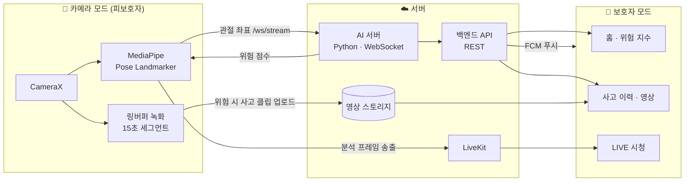

# 늘봄 (OnSafe)

> 스마트폰 카메라 한 대로 어르신의 낙상을 감지하고, 보호자에게 바로 알려 주는 안드로이드 앱

[](https://drive.google.com/file/d/1kmh9wtWcIfFm10jwSXxq1C6ilSy-wKwV/view)
[](https://github.com/seoyeon59/OnSafe/releases)
-blue)


남는 스마트폰을 피보호자(어르신) 방에 세워 두면 **카메라 모드**가 자세(관절 좌표)를 실시간으로 분석해 낙상 위험 점수를 계산합니다.
위험이 감지되면 사고 전후 영상을 자동으로 저장하고, **보호자 모드**로 로그인한 가족에게 푸시 알림을 보냅니다.
보호자는 언제든 실시간 영상(LIVE)으로 상태를 확인할 수 있습니다.

---

## 📥 설치

1. **[APK 다운로드 (Google Drive)](https://drive.google.com/file/d/1kmh9wtWcIfFm10jwSXxq1C6ilSy-wKwV/view)**
2. 휴대폰에서 파일을 열고, "출처를 알 수 없는 앱 설치"를 허용한 뒤 설치합니다.
3. 보호자 휴대폰과 피보호자(카메라용) 휴대폰에 **각각** 설치하고, 서로 다른 계정으로 가입합니다.

> 지원 환경: Android 7.0 (API 24) 이상 · 카메라 모드는 후면/전면 카메라와 네트워크 연결이 필요합니다.

---

## ✨ 주요 기능

### 보호자 모드
| 기능 | 설명 |
|---|---|
| 위험 지수 | 연결된 피보호자의 실시간 낙상 위험 점수(0~100)와 단계 표시 |
| LIVE 시청 | 피보호자 카메라 영상을 실시간 시청 (LiveKit). 앱을 보고 있는 동안 자동 연장, 이탈·백그라운드 시 종료 |
| 사고 이력 | 낙상 의심 이벤트 목록 · 썸네일 · 사고 전후 영상 재생/다운로드 · 확인 처리 · 삭제 |
| 알림 | FCM 푸시 알림 + 알림함. 낙상 알림은 휴대폰이 무음·진동 모드여도 경보음·진동으로 울림 |
| 페어링 | 6자리 코드를 발급해 피보호자 계정과 1:1 연결 / 연결 해제 |
| 설정 | 프로필 수정, 알림·소리·진동, 마케팅 수신, 영상 동의 확인, 로그아웃·회원 탈퇴 |

### 카메라(피보호자) 모드
| 기능 | 설명 |
|---|---|
| 자세 추적 | MediaPipe Pose Landmarker로 기기 안에서 관절 좌표 추출 → AI 서버로 WebSocket 전송 |
| 낙상 판정 | 서버가 돌려준 위험 점수로 화면에 단계 표시, 위험 시 사고 클립 생성 |
| 사고 영상 저장 | 15초 단위 링버퍼 녹화 → 위험 순간 **전 약 2분 + 후 약 2분**을 재인코딩 없이 이어 붙여 업로드 |
| LIVE 송출 | 보호자가 시청을 요청하면 분석 중인 프레임을 그대로 송출, "보호자가 보는 중" 배지 표시 |
| 영상 동의 | 피보호자가 LIVE 영상 제공 여부를 직접 켜고 끔. 철회 즉시 송출 중단 |
| 화면 보호기 · 회전 | 장시간 촬영용 화면 보호기, 가로 양방향 회전 시에도 카메라·연결·버퍼 유지 |
| 자동 재연결 | 서버 연결이 끊기면 토큰 갱신 후 백오프 재연결 |

### 위험 지수 단계
| 점수 | 단계 | 안내 |
|---|---|---|
| 0 ~ 50 | 🟢 정상 | 안정적인 상태입니다. |
| 51 ~ 75 | 🟡 주의 | 움직임에 주의가 필요합니다. |
| 76 ~ 100 | 🔴 위험 | 낙상이 의심됩니다. 즉시 확인이 필요합니다. |

---

## 🧭 앱 흐름

```
로그인 ─┬─ 회원가입 (2단계, 도로명주소 검색은 선택)
        ├─ 아이디 / 비밀번호 찾기
        └─ 로그인 성공
              ↓
         튜토리얼(5장) → 권한 요청 → 모드 선택
                                     ├─ 보호자 모드 → 홈(위험 지수·LIVE) · 사고 이력 · 알림 · 설정
                                     └─ 카메라 모드 → 촬영 · 낙상 감지 · LIVE 송출
```

보호자·피보호자는 각자 계정으로 로그인한 뒤 **6자리 페어링 코드**로 연결합니다.
보호자 화면의 위험 지수·사고 이력·영상은 연결된 피보호자 ID 기준으로, 알림함은 보호자 본인 ID 기준으로 조회합니다.

---

## 🏗 시스템 구조



- **영상 원본은 기기 밖으로 나가지 않습니다.** 낙상 판정에는 관절 좌표만 전송하고, 영상은 사고 클립과 (동의한 경우) LIVE 시청에만 사용합니다.
- 사고 보관 기간(사고 30일 · 알림 7일)은 서버에서 관리합니다.

---

## 🛠 기술 스택

| 분류 | 사용 기술 |
|---|---|
| 언어 · 빌드 | Kotlin 1.9, Gradle (Kotlin DSL, Version Catalog), AGP 8.5 |
| 플랫폼 | Android SDK 35 (minSdk 24), View 기반 UI + ViewModel / Coroutines |
| 카메라 · 영상 | CameraX 1.3 (Preview · ImageAnalysis · VideoCapture), MediaMuxer 클립 합성 |
| 포즈 추정 | MediaPipe Tasks Vision 0.10 (`pose_landmarker_lite.task`) |
| 네트워크 | Retrofit 2 + OkHttp 4 (REST · WebSocket), JWT 자동 갱신 |
| 실시간 영상 | LiveKit Android SDK 2.29 |
| 푸시 | Firebase Cloud Messaging |
| 보안 | EncryptedSharedPreferences (토큰 암호화 저장) |
| 주소 검색 | 행정안전부 도로명주소 API (juso.go.kr) |
| AI 벤치마크 | Python, MediaPipe, OpenCV, scikit-learn(joblib), Redis, Firestore |

---

## 📂 프로젝트 구조

```
OnSafe/
├── android/                         # 안드로이드 앱 (늘봄)
│   ├── app/src/main/
│   │   ├── java/com/example/on_safe/
│   │   │   ├── ui/
│   │   │   │   ├── login/           # 로그인 · 회원가입 · 계정 찾기 · 권한 · 모드 선택
│   │   │   │   ├── tutorial/        # 튜토리얼
│   │   │   │   ├── camera/          # 카메라 모드: 포즈 추정, WS 스트림, 링버퍼 녹화, 클립 업로드, LIVE 송출
│   │   │   │   ├── live/            # 보호자 LIVE 시청
│   │   │   │   ├── history/         # 사고 이력 · 썸네일 · 영상 플레이어
│   │   │   │   ├── notification/    # 알림함
│   │   │   │   ├── pairing/ main/   # 페어링 · 연결 해제
│   │   │   │   └── settings/        # 설정 · 프로필 · 탈퇴
│   │   │   ├── network/             # Retrofit API, DTO, AI 서버·주소 API 클라이언트
│   │   │   ├── data/repository/     # 사고 이력 · 알림 · 피보호자 데이터 소스
│   │   │   ├── messaging/           # FCM 수신, 푸시 알림, 무음 모드 낙상 알람
│   │   │   └── util/                # 토큰 관리, 입력 검증, 공통 UI 유틸
│   │   ├── assets/pose_landmarker_lite.task
│   │   └── res/                     # 레이아웃 · 아이콘 · 폰트(Pretendard)
│   ├── design/icon_source/          # 아이콘 SVG 원본
│   └── PROGRESS.md                  # 프론트엔드 진행 현황
└── ai-server/benchmark/             # 낙상 판정 파이프라인 저장소별 성능 비교 스크립트
```

---

## 🚀 개발 환경 설정

### 요구 사항
- Android Studio (Koala 이상 권장), JDK 17
- 테스트 기기 또는 에뮬레이터 (Android 7.0+)

### 1. 클론
```bash
git clone https://github.com/seoyeon59/OnSafe.git
```
Android Studio에서 `android/` 폴더를 프로젝트로 엽니다.

### 2. `android/local.properties` 설정
저장소에 커밋하지 않는 로컬 설정입니다. 값이 없어도 빌드는 되지만 해당 기능이 동작하지 않습니다.

```properties
sdk.dir=...                  # Android Studio가 자동 생성
JUSO_API_KEY=발급받은_키       # 도로명주소 검색 API 키 (juso.go.kr)

# 디버그 빌드가 접속할 개발 서버 (기본값: 에뮬레이터 → 개발 PC localhost)
DEV_SERVER_HOST=10.0.2.2     # 실기기는 localhost + adb reverse
DEV_API_PORT=8080            # 백엔드 API 포트
DEV_AI_PORT=8000             # AI 서버 포트
```

실기기에서 개발 PC 서버에 붙을 때:
```bash
adb reverse tcp:8080 tcp:8080
```
```bash
adb reverse tcp:8000 tcp:8000
```

### 3. Firebase (푸시 알림)
Firebase 콘솔에서 패키지명 `com.example.neulbom` 앱의 `google-services.json`을 내려받아 `android/app/`에 둡니다.
파일이 없으면 Google Services 플러그인이 적용되지 않고 푸시 기능만 꺼진 채로 빌드됩니다.

### 4. 빌드 · 실행
```bash
cd android && ./gradlew assembleDebug
```
APK 위치: `android/app/build/outputs/apk/debug/app-debug.apk`

> ⚠️ 시크릿 파일(`google-services.json`, `local.properties`, Firebase 서비스 계정 키)은 `.gitignore`로 제외되어 있습니다. 절대 커밋하지 마세요.

---

## 🔌 API 개요

앱이 사용하는 서버 엔드포인트 (`network/ApiService.kt`, `network/AiApiService.kt`)

| 그룹 | 경로 | 내용 |
|---|---|---|
| 인증 | `/api/auth/*` | 로그인 · 회원가입 · 중복 확인 · 아이디 찾기 · 비밀번호 재설정 · 토큰 갱신 |
| 사용자 | `/api/users/{userId}` | 프로필 조회/수정, 비밀번호 확인, FCM 토큰 등록 |
| 페어링 | `/api/guardian/{userId}/*` | 코드 발급 · 연결 · 승인/거절 · 연결 상태 · 해제 |
| 설정 · 동의 | `/api/settings/*`, `/api/consents/*` | 알림 · 마케팅 · LIVE 영상 동의, 약관 재동의 |
| 카메라 | `/api/camera/*` | 위험 점수 조회, 카메라 상태 heartbeat |
| LIVE | `/api/live/*` | 시청 세션 시작/종료, 송출 토큰 발급 |
| 사고 이력 | `/api/fall-logs/*` | 목록 · 영상 URL · 업로드 URL · 업로드 완료 · 확인 · 삭제 |
| 알림 | `/api/notifications/*` | 알림 목록 · 읽음 처리 |
| 기기 (AI 서버) | `/api/devices/{userId}` | 카메라 기기 등록/조회 |
| 스트림 (AI 서버) | `ws /ws/stream` | 관절 좌표 전송 · 위험 점수 수신 |

---

## 📊 AI 서버 벤치마크

`ai-server/benchmark/`에는 낙상 판정 파이프라인(관절 추출 → 전처리 → 특징 생성 → 모델 추론 → 위험 점수)의 결과를 어디에 기록할지 비교한 스크립트가 있습니다.
(AI 서버 런타임 코드는 별도로 운영하며, 이 저장소에는 벤치마크만 남겨 두었습니다.)

| 스크립트 | 비교 대상 |
|---|---|
| `benchmark_eventlog.py` | 저장소 없이 콘솔 이벤트 로그만 (기준선) |
| `benchmark_redis.py` | Redis 기록 |
| `benchmark_firestore.py` | Firestore 기록 |
| `benchmark_compare.py` | Redis vs Firestore 지연 시간 비교 |

---

## 📝 남은 작업

- 운영 서버 주소 확정 후 릴리즈 빌드 `BASE_URL` / `AI_WS_URL` / `AI_BASE_URL` 교체 (`android/app/build.gradle.kts`)
- 릴리즈 서명 · 난독화 빌드 검증, Firebase · LiveKit 운영 설정, 주소 검색 운영 키
- 별도 계정 두 기기로 LIVE · 동의 철회 · 송출 중 낙상 감지 실서버 E2E 검증

자세한 진행 현황은 [`android/PROGRESS.md`](android/PROGRESS.md)를 참고하세요.

---

## 👥 Contributors

<a href="https://github.com/seoyeon59/OnSafe/graphs/contributors">
  
</a>
